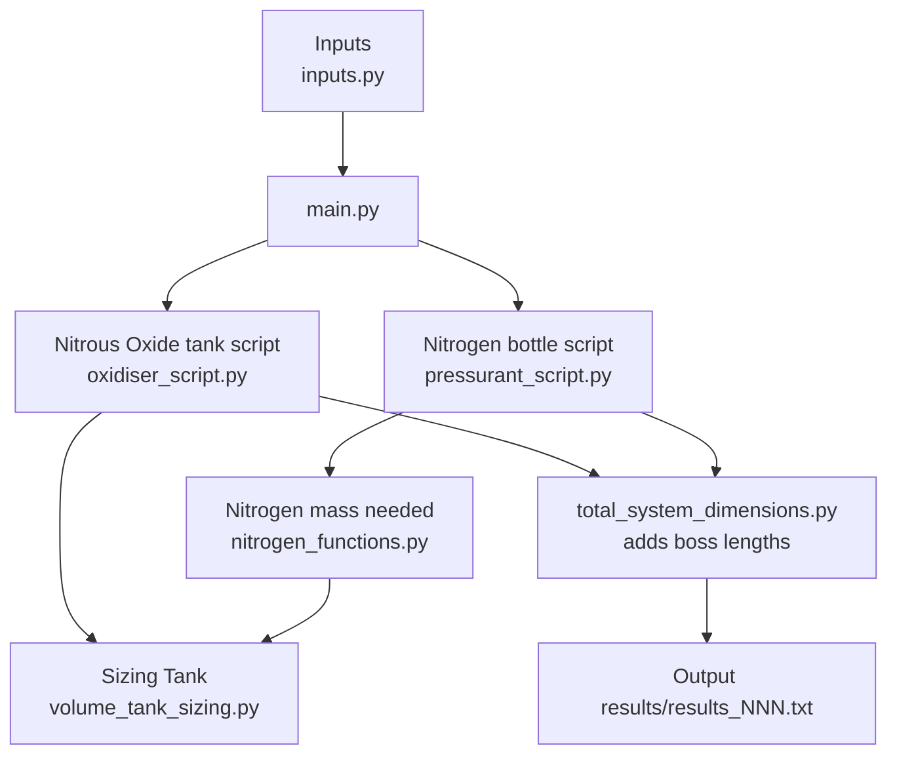

# COPV-Tank-Solver

A Python tool for sizing a **Type 3 COPV** (Composite Overwrapped Pressure Vessel: an aluminium liner wrapped in carbon fibre) pressurant system for a nitrous oxide hybrid rocket. It sizes two tanks:

- **Nitrous oxide (N2O) tank**: stores the oxidiser.
- **Nitrogen (N2) bottle**: a high-pressure bottle that pressurises the N2O tank through a regulator.

From your inputs it calculates tank dimensions, wall thicknesses and the nitrogen needed, then writes a results file. A separate script generates the geodesic dome profile for CAD.

## How it works



1. **Required volume.** For N2O, the liquid density comes from CoolProp at ambient temperature and MEOP, and the volume is the mass divided by density plus the ullage (the gas space left in the tank). For N2, the volume comes from the mass of gas needed to push the oxidiser out.
2. **Netting analysis** (`netting_calc.py`). The outer radius is fixed, and the wall is worked inwards from it. The overwrap thickness comes from the netting equations, with design pressure = MEOP × safety factor. The aluminium liner thickness comes from the thin-wall axial formula.
For the winding angle and the helical/hoop split, see `Manufacturing/COPV_Netting_Analysis.py` below.
3. **Dome geometry** (`dome_dimensions.py`). The domes are geodesic, meaning the fibre follows the shortest path so it doesn't slip during winding. A geodesic dome can't reach the polar boss opening, so it hands off to a small spherical cap at 1.23 × the boss radius. The result is the volume and depth of one dome.
4. **Tank length.** Cylinder length = (required volume − 2 domes) / cylinder cross-section. Total length = cylinder + 2 dome depths.
5. **System length.** The boss lengths are added to give the total length of both tanks.

### Nitrogen requirement

`nitrogen_functions.py` works out how much N2 is needed in two parts:

- **Pad gas**: the N2 that raises the initial ullage up to the N2O vapour pressure. It uses Dalton's law.
- **Burn gas**: the N2 that fills the volume vacated by the oxidiser during the burn. An energy balance on the ullage, with the bottle gas discharging isentropically, gives the final ullage temperature.

A 10 % margin is added on top. The bottle volume is then sized so that its pressure is still above the regulator setpoint plus a minimum margin when the burn ends.

## Repository structure

```
main.py                     Runs the full sizing and writes the results file
Inputs/inputs.py            All user inputs (edit this)
Calculations/               Sizing maths
  oxidiser_script.py          N2O tank sizing
  pressurant_script.py        N2 bottle sizing
  nitrogen_functions.py       N2 mass and bottle volume
  volume_tank_sizing.py       Shared: volume -> tank dimensions
  netting_calc.py             Wall thicknesses
  dome_dimensions.py          Dome volume and depth
  total_system_dimensions.py  Adds boss lengths
  coolprop_functions.py       Fluid property wrappers
  Basic_Functions/            Input handling, reporting, tables
Manufacturing/              CAD and manufacturing outputs
  COPV_Netting_Analysis.py    Winding angle and layer thicknesses
  Geodesic_Dome.py            Dome profile -> CSV, plots, DXF
  Plotting.py, DXF_Export.py  Helpers for the above
Outputs/                    Example results for different diameters
```

## Installation

Requires Python 3.10+ and NumPy 2.0+.

```bash
pip install -r requirements.txt
```

## Usage

### 1. Size both tanks

Edit `Inputs/inputs.py`, then run:

```bash
python main.py
```

Results are saved to `results/results_001.txt` (the number increments each run). Example outputs for different tank diameters are in `Outputs/`.

### 2. Export the dome profile for CAD

This is a separate script and is **not** run by `main.py`.

1. Create a `.env` file in the repo root with the output folder:
   ```
   DIRECTORY=C:/path/to/output/folder
   ```
2. Set the values under *General Tank Properties* in `Inputs/inputs.py`.
3. Run:
   ```bash
   python -m Manufacturing.Geodesic_Dome
   ```

### 3. Winding parameters (netting analysis)

Calculates the filament winding values for the overwrap of a single tank. It is a separate script and is **not** run by `main.py`.

1. Set the values under *General Tank Properties* in `Inputs/inputs.py` (radius, MEOP, safety factor, polar boss opening) and the material inputs.
2. Run:
   ```bash
   python -m Manufacturing.COPV_Netting_Analysis
   ```
Netting theory is used here as well: fibres carry all the load, and the resin carries none.

This produces `dome_inner.csv`, `dome_outer.csv`, `dome_profile.dxf` and two plots (dome profile and full tank profile) in that folder.

## Inputs

All inputs live in `Inputs/inputs.py` in SI units (Pa, m, kg, °C), except the boss thread lengths, which are in mm. The main ones:

| Group | Inputs |
|---|---|
| Materials | Fibre allowable stress, translation efficiency, fibre volume fraction, aluminium yield strength |
| N2O tank | Diameter, MEOP, safety factor, ullage fraction, N2O mass, boss opening |
| N2 bottle | Diameter, bottle pressure, regulator pressure, minimum regulator margin, safety factor, boss opening |
| Operating | Ambient, min and max temperature |
| Bosses | Minimum thread lengths per boss, plumbing length |

## Assumptions and limitations

- Netting theory: the fibres carry all the load and the resin carries none.
- The liner is sized with the thin-wall axial formula, and the overwrap is sized to carry the full design pressure on its own.
- Dome volume uses the dome and cap geometry above, with the wall thickness measured normal to the surface.
- Fluid properties are real-gas values from CoolProp.
- Preliminary design only. Validate with FEA and burst testing before manufacture.
